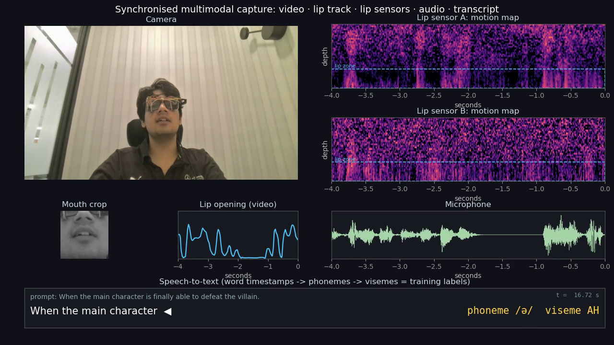

# Setu Glasses

<p align="center">
  <a href="media/setu-demo.mp4"></a>
</p>
<h3 align="center">▶ <a href="media/setu-demo.mp4">Watch the demo (22 s)</a> · <a href="media/setu-demo-short.mp4">short cut (11 s)</a></h3>
<p align="center"><i>Our capture rig, live: camera, lip track, both lip sensors, microphone and speech-to-text training labels, all on one clock.</i></p>

**Talk without making a sound.** Setu is a pair of glasses with small contactless sensors in the frame
that read lip movement, so you can mouth words silently and a voice agent speaks, calls and answers for you in
English, Hindi and 9 more Indian languages.

> Built for the Bolna × YC Symphony Buildathon 2026. *Setu* (सेतु) means "bridge": between silent lips and a voice.

| | |
|---|---|
| **Input** | Silent lip movement, read by contactless sensors in the glasses frame. No camera, no microphone. |
| **Recognition** | On-device neural recogniser, from a closed set of 20 phrases today toward open vocabulary ([results](docs/RESULTS.md)) |
| **Voice layer** | [Bolna](https://www.bolna.ai) voice agent over Plivo / Exotel telephony. Sarvam, Cartesia and Kalpa Labs voices. Deepgram and Sarvam speech recognition. An LLM that picks the right phrase from context. |
| **Languages** | 11 for speech output and phone calls (en, hi, bn, ta, te, gu, kn, ml, mr, pa, od) |

## Why

Voice is becoming the main way to use AI, phones and glasses, but speaking out loud isn't always
possible or welcome:

* **Consumer:** talking to your AI assistant or answering a message on the metro, in a library, in a
  meeting or at 2 am next to someone sleeping, without broadcasting it.
* **Prosumer:** commands and calls on factory floors, airport aprons and hospital wards, where it's
  too loud or too quiet to speak.
* **Care (our beachhead):** people who can't voice speech at all, after a laryngectomy, with ALS or MND,
  or on a ventilator. Today they use slow tablets and boards.

Smart glasses are the fastest-growing personal device: IDC forecasts 13.6 M units in 2026. Voice input
is a $2 B category (Wispr, Aug 2026). Silent speech is the missing input for both. See [docs/MARKET.md](docs/MARKET.md).

## What it does today

1. **Silent phrase → voice.** Mouth one of 20 phrases ("thank you", "say that again", "play music",
   "i need water"). The glasses say it aloud in your chosen language or voice, or run a device command.
   When you're not mouthing anything, a "stay still" reject class keeps them quiet.
2. **Silent phone calls.** Mouth "call my family". A Bolna agent calls the saved number through
   Plivo and introduces you. When the other person asks you something, the agent calls our
   `ask_user` function. You hear the question in your earpiece and mouth the answer. An LLM picks
   the most likely of the recogniser's top candidates given the question, and the agent says it.
3. **Your own voice.** English output can use a Cartesia voice cloned from your own recordings, and
   Indian languages use Sarvam Bulbul voices.
4. **Multilingual data engine.** Paired sensor + audio + video sessions are auto-labelled with Deepgram Nova-3
   and Sarvam Saaras, with a two-provider agreement check. TTS-paced prompts label silent sessions,
   which have no audio. Every new language needs speakers, not transcribers.

```
 lips ─► lip sensors      ─► on-glasses recogniser ─► top-k phrases ─► Setu relay ─┬─► speak (Sarvam / Cartesia)
              (private)            (private)          (JSONL)        (this repo)  ├─► Bolna call (Plivo / Exotel)
                                                                                  │     └─ ask_user ◄─ caller's question
                                                                                  └─► device command
```
Details: [docs/ARCHITECTURE.md](docs/ARCHITECTURE.md) · partner stack: [docs/PARTNERS.md](docs/PARTNERS.md)

## Results (measured, held-out wearings)

Silent speech decoding of full read sentences. Every model is tested on sessions it never trained on,
with the glasses taken off and put back on between sessions. Test set: 179 sentences / 1,270 words /
6,372 characters from 4 held-out sessions. Training data: 1,638 sentences / ~12,700 words.

| Metric (lower is better) | Best model |
|---|---|
| Word error rate, known-sentence decoding | **34.9%** |
| Sentences decoded exactly right | **61%** |
| Character error rate, known-sentence decoding | **28.9%** |
| Word error rate, open decoding (lexicon + language model) | **55.0%** |
| Word error rate as training grows 4 → 22 sessions | **97% → 44%**, still falling |

Full tables (WER / CER / SER per decoding mode, seeds, scaling, unseen sentences):
[docs/RESULTS.md](docs/RESULTS.md). Decoding brand-new sentences, outside the recorded prompt list, is
the open frontier, and more diverse data is what moves it.

## Long-term: sentence-level silent speech

Phrases are the product today. Open-vocabulary sentence decoding is the long-term effort, and it's driven by
data. We built a capture pipeline that records **lip sensors + audio + video** in one session, puts them
on a shared clock, transcribes the audio with **speech-to-text** for word-timed labels, converts words to
phone-level targets, tracks the lips in video for quality control and as a future teacher signal, and
trains on cloud GPUs with strict held-out evaluation. So far that's about 2 hours, 39 sessions and 1,638 sentences (~12,700 words),
including a pool of 3,828 never-repeated everyday sentences. Partner STT (Deepgram, Sarvam) and TTS-paced
silent prompts take the pipeline to Indian languages and to silent sessions.
Pipeline, results, failed experiments and roadmap: [docs/RESEARCH.md](docs/RESEARCH.md).

## Quick start (software layer)

```bash
git clone https://github.com/akulsylvania/setu-glasses && cd setu-glasses
pip install -e .            # Python ≥ 3.10, standard library only
cp .env.example .env        # add Bolna / Sarvam / Cartesia / Deepgram keys
python -m unittest discover -s tests          # test suite
setu doctor                                   # check every partner key
setu simulate samples/demo_call.json --mute   # scripted silent call through the relay
setu agent-spec --lang hi --voice sarvam      # the Bolna agent definition
setu create-agent --lang en --voice cartesia  # create it in Bolna
setu run --decoder live.jsonl                 # live: glasses -> speak / call + ask_user bridge
setu call family                              # silent call to a saved contact
setu label session.wav --lang hi              # Deepgram + Sarvam labels for training data
```

For live calls, expose the bridge (`cloudflared tunnel --url http://localhost:8787`), set `SETU_PUBLIC_URL`
and `SETU_BRIDGE_TOKEN`, create the agent, and connect your Plivo or Exotel number in the Bolna dashboard.

## Repository

| Path | |
|---|---|
| `setu/relay.py` | runtime: utterances → speak / call / device; the ask_user question-and-answer loop |
| `setu/agent/` | Bolna client and agent definition (telephony, transcriber, synthesizer, LLM, custom functions) |
| `setu/bridge.py` | HTTP endpoints for Bolna custom functions and webhook |
| `setu/llm.py` | context-aware phrase choice and phrase → sentence (any OpenAI-compatible LLM) |
| `setu/voice/` | Sarvam (TTS, STT, translate), Cartesia (TTS), Deepgram (STT) |
| `setu/datasets.py` | multilingual labelling, agreement check, TTS-paced silent prompts |
| `setu/decoder.py` | JSONL interface to the on-glasses recogniser |
| `agents/` | rendered Bolna agents: English + Cartesia, Hindi + Sarvam, Hinglish + Kalpa on Exotel |
| `samples/` | recogniser output format, a scripted call, reading prompts |
| `models/` | model card (weights are not published) |

## What's not in this repo

The sensor hardware and firmware, signal processing, recogniser architecture, training code, trained weights and
recordings are proprietary. See [docs/PRIVACY_IP.md](docs/PRIVACY_IP.md).
We can demo them live and walk through them under NDA.

## Team: Setu Labs

* [@akulsylvania](https://github.com/akulsylvania)
* Divyaratna Joshi
* Arush Singhal

© 2026 Setu Labs. All rights reserved. See [LICENSE](LICENSE).
