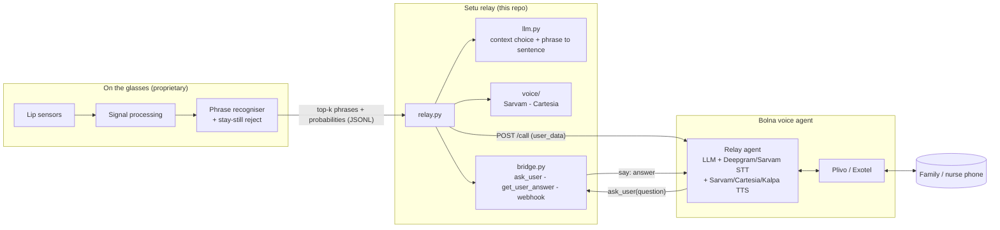

# Architecture

## A silent call, step by step

1. The wearer mouths **"call my family"**. The recogniser emits `{"top": [["call my family", 0.64], ...]}`.
2. `Relay.act()` sees a `call` phrase and calls `Bolna.make_call(agent_id, +91..., user_data)` with
   `user_name`, `session_id`, `opening_line`, `call_reason` and `language_name`. These fill the agent's
   `{{variables}}`.
3. The Bolna agent dials through Plivo and opens with the `opening_line`, in the wearer's cloned voice
   (Cartesia) or a Sarvam voice in their language.
4. The family member says *"Is everything okay?"*. Deepgram or Sarvam transcribes it, and the agent's LLM
   calls the custom function **`ask_user`** (`POST {bridge}/bolna/ask_user`, bearer token).
5. The bridge speaks the question into the wearer's earpiece and holds the request open for up to 12 s.
6. The wearer mouths **"yes"**. `llm.choose()` sees the recogniser's top candidates plus the question
   and picks only among those candidates. A yes/no question boosts yes and no. Stay-still or low
   confidence returns "none" and asks the wearer to mouth it again.
7. `llm.expand()` turns the phrase into a sentence, which goes back as `{"status": "answered", "say": "..."}`,
   and the agent says it. If the wearer needs longer, the function returns `pending` and the agent calls
   `get_user_answer`.
8. Bolna's webhook reports the call status. When the call ends, the wearer hears "Call ended."

## Design rules

* **The LLM never makes up the wearer's words.** It may only choose among the recogniser's candidates
  or choose none. Without an LLM, deterministic rules give the same behaviour, a little less accurately.
* **Silence is a class.** Stay-still is trained explicitly, so the glasses don't speak by accident.
* **The confidence threshold is a product setting.** It trades how often the glasses speak against how
  often they're right, and is tuned per wearer on held-out sessions.
* **Only phrase probabilities leave the recogniser.** Raw sensor data stays on the device.
